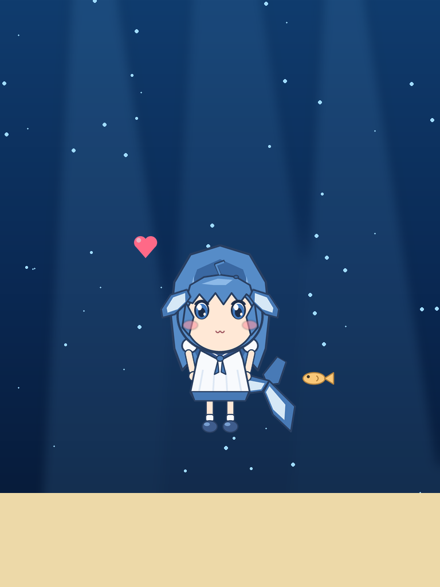

# 鲸鱼娘 DSH 宠物 🐋

一位住在 iPad 全屏海底世界里的**鲸鱼娘**——蓝发女仆裙 Q 版少女，鲸尾 + 鳍耳，立绘来自开源项目
[dsh-whale-musume](https://github.com/Sutera-Diffusus/dsh-whale-musume)（MIT）。

为 **iPad mini 4（A8 / 2GB RAM / iPadOS 15.8.x）** 量身打造：SpriteKit 整图切换 + 程序化运动动画，
30fps 低功耗；再通过一个 **DSH Host 插件**把语音接进你本机正在运行的 DeepSeek Harness——
宠物会话就是完整的 DSH Agent：能查资料、跑命令、改文件，任务开始/完成/需要授权会主动提醒，
**会话不用你管**。

| 部分 | 版本 | 说明 |
|---|---|---|
| iPad App（`WhalePet/`） | **v1.2.3** | SpriteKit 宠物 + 语音采集/TTS + 网关客户端 |
| DSH 插件（`Plugin/whalepet-dsh-bridge/`） | **0.2.1** | 局域网网关：ASR / 唤醒词 / 会话 / 任务提醒 |



## 项目结构

```
ipadpet/
├── WhalePet/                 # iPad App 源码（SwiftUI 之外的纯 UIKit + SpriteKit）
│   ├── Pet/                  #   状态机、数值、存档、台词
│   ├── Scenes/  UI/          #   SpriteKit 场景、气泡、HUD
│   ├── Voice/                #   AVAudioEngine 采集、AVAudioConverter 16k、TTS
│   ├── Networking/           #   DSHClient（HTTP + WebSocket，iOS 15 兼容）
│   ├── Support/              #   AppDelegate / ViewController / 服务器设置（Keychain）
│   └── Resources.xcassets/   #   立绘与图标（来自上游 MIT 素材）
├── WhalePetTests/            # 纯逻辑 XCTest（状态机/数值/存档/配置校验）
├── Plugin/
│   └── whalepet-dsh-bridge/  # DSH Host 插件（局域网网关，零第三方依赖）
│       ├── index.js          #   插件入口：会话/人格/权限/任务提醒
│       ├── src/              #   传输层（server/ws）、VAD、唤醒词、WAV
│       ├── test/             #   node:test：纯逻辑 + 真 HTTP/WS + 假 ctx 集成
│       ├── cordis.patch.yml  #   bundle 配置（端口/权限预设/会话轮换）
│       └── README.md         #   插件安装、协议、配置、排障
├── Tools/
│   ├── art/                  # 素材导入/生成脚本
│   ├── scripts/check.py      # Linux 侧静态自检（Swift/资产/权限/插件测试）
│   └── deploy/               # PM2 部署：dsh-web.sh（直连本地 dsh）、pm2-switch.sh
├── docs/
│   ├── ARCHITECTURE.md       # 整体架构、协议、会话策略、排障
│   ├── DESIGN.md             # 设计取舍与 A8 性能预算
│   ├── refs/                 # DSH Host API / bundle 打包契约调研
│   ├── preview.png
│   ├── ACKNOWLEDGEMENTS.md   # 开源参考致谢
│   └── THIRD-PARTY-NOTICES.md
├── project.yml               # XcodeGen 工程唯一事实源（.xcodeproj 不入库）
├── LICENSE
└── README.md
```

## 架构

```
iPad App ──HTTP/WS(16kHz PCM)──▶ 插件 whalepet-bridge :8787 ──▶ 工作 DSH
                                    ├─ ctx.speechToText   SenseVoice（本地 CPU）
                                    ├─ 唤醒词 / VAD / 状态机
                                    └─ ctx.sessionController → 完整 Agent 会话
```

细节（协议、事件、会话轮换、安全边界）见 **[docs/ARCHITECTURE.md](docs/ARCHITECTURE.md)**。

## 能力

| 能力 | 说明 |
|---|---|
| 语音唤醒 | 说「**小鲸小鲸**」唤醒，停顿后说指令；也支持一句话带命令 |
| 真 Agent | 宠物会话是完整的 DSH Agent：联网检索、读文件、跑命令、多步执行（默认权限 `workspace-write`） |
| 任务提醒 | 任务**开始**气泡提示；**需要授权**时语音提醒「去 DSH 点同意」，批准后自动继续；**完成/失败**气泡提示 |
| 不用管会话 | 只有一个长期会话，空闲自动归档（列表不可见），每 24h 自动换新，历史由 DSH 自动压缩 |
| 本地播报 | 回复经口语化清洗后用 AVSpeechSynthesizer 播放；播报期间自动闭麦防自触发 |
| 离线宠物 | 不连服务器也能摸头/投喂/玩耍/睡觉，数值与存档都在本地 |
| 设备适配 | iPadOS 15 部署目标、A8 省电预算、四方向自适应、全屏独占 |

## 快速开始

### 1. DSH 侧（一次性）

前置：当前 profile 已启用语音输入 bundle（`speech-to-text` 行、`defaultProvider: sensevoice-local`）
与 Web 会话控制器；插件只 `inject` 这些服务，不重复插入。

```bash
# 在 DSH 里安装插件（绝对路径；安装会写入 profile 的 package.json 与 bundle 列表）
plugin_manager { action: "install_bundle",
                 target: "/home/dywu/Samba/workspace/ipadpet/Plugin/whalepet-dsh-bridge" }
```

- 令牌：首次启动自动生成在 **`~/.dsh/whalepet/ipad-token`**（0600，重启不变）；
- 配置（端口、权限预设、会话轮换、人名/唤醒词等）在
  [Plugin/whalepet-dsh-bridge/cordis.patch.yml](Plugin/whalepet-dsh-bridge/cordis.patch.yml)，
  也可在 profile 的 patch 里按 id `whalepet-bridge` 覆盖；
- 运行数据都在 `~/.dsh/whalepet/`：`ipad-token`、`access.log`、`sessions` 元数据、宠物工作目录 `workspace/`。

### 2. iPad 侧（需要一台 Mac）

```bash
# 1）生成工程（project.yml 是唯一事实源）
brew install xcodegen
xcodegen generate

# 2）打开并真机运行
open WhalePet.xcodeproj
```

Xcode 里选 WhalePet target → Signing 选免费 Apple ID（7 天有效期）→ 连 iPad mini 4 → ⌘R。
首次运行允许「本地网络」与「麦克风」权限。

在 App 里点 **⚙️ → 语音服务器**，填：

- 服务器地址：`http://<运行 DSH 的机器 IP>:8787`（同一 WiFi 填局域网 IP；走 ZeroTier 填 ZeroTier IP）
- 访问令牌：`~/.dsh/whalepet/ipad-token` 的内容

点「保存并测试」，提示「连接成功」即可说「小鲸小鲸」。

## 配置（插件）

见 [Plugin/whalepet-dsh-bridge/README.md](Plugin/whalepet-dsh-bridge/README.md)，常用项：

| 键 | 默认 | 说明 |
|---|---|---|
| `host` / `port` | `0.0.0.0` / `8787` | 监听地址；iPad 连接的端口 |
| `wakePhrase` / `wakeAliases` | `小鲸小鲸` + 同音别名 | 唤醒词表 |
| `permissionPreset` | `workspace-write` | 宠物会话权限预设（沙箱 + 审批组合） |
| `rotateAfterHours` | `24` | 每 N 小时自动换新会话；`0` = 永久同一个 |
| `archiveWhenIdle` | `true` | 空闲归档（DSH 列表不可见），说话前自动恢复 |
| `requestTimeoutMs` / `maxWaitMs` | `300000` / `600000` | 单次等待 / 单轮最长等待 |
| `voicePersona` | 内置鲸鱼娘人格 | 自定义宠物人格（仅作用于宠物会话） |

## 测试与自检

```bash
# Linux 侧全量静态自检（Swift 括号、工程配置、纹理引用、显存预算、权限声明、插件测试）
python3 Tools/scripts/check.py

# 插件单元/集成测试（43 个）
cd Plugin/whalepet-dsh-bridge && node --test test/*.test.js
```

Swift 编译与真机验证必须在 macOS + Xcode 上做，Linux 侧只能做静态哨兵。

## 部署（PM2，可选）

`dsh web` 默认只监听 `127.0.0.1:3080`；若用 nginx/ZeroTier 暴露浏览器界面，建议用直连入口托管：

```bash
# 首次：把 PM2 里的 dsh 从 npx 切到本地安装（带失败回退，日志 Tools/deploy/pm2-switch.log）
pm2 start Tools/deploy/pm2-switch.sh --name dsh-switch --interpreter bash --no-autorestart
```

`Tools/deploy/dsh-web.sh` 会按「npx 缓存 → npm 全局 → npx 兜底」直连已安装的 dsh，避免
`npx @latest` 在 registry 抽风时静默崩溃、PM2 重启循环。

## 文档

- [架构与协议](docs/ARCHITECTURE.md)
- [设计说明（含 A8 性能预算）](docs/DESIGN.md)
- [插件 README（安装/协议/配置/排障）](Plugin/whalepet-dsh-bridge/README.md)
- [DSH Host API 调研](docs/refs/dsh-host-api.md) · [bundle 打包契约](docs/refs/dsh-bundle-packaging.md)
- [开源参考致谢](docs/ACKNOWLEDGEMENTS.md) · [第三方素材许可](docs/THIRD-PARTY-NOTICES.md)

## 已知限制

- 语音只在 App 前台工作（iOS 不允许后台常驻麦克风）；后台时任务仍在服务器继续，回来可看会话；
- 语音识别是**整段非流式**（SenseVoice 限制），按句切分后整句送识别；
- VAD 是轻量能量检测（无原生依赖），安静室内够用，嘈杂环境可调 `vadFloorDbfs` / `vadMarginDb`；
- 8787 是明文 HTTP + Bearer，仅用于内网/ZeroTier，**不要暴露公网**。

## 版本历史

| 版本 | 内容 |
|---|---|
| v1.2.3 | 断线自动重连（1/2/4/8/16/30s 退避，401 不重试）；重连时补启采集 |
| v1.2.2 | 任务开始/完成/需要授权提醒；`task` 事件 |
| v1.2.1 | 修复 `VoiceController.start()` 重复建连（双 WebSocket / 双音频引擎） |
| v1.2.0 | 语音唤醒 + 接入 DSH（当时用独立 Python 桥接 `Server/`） |
| v1.1.0 | 改用开源成品立绘 |
| v1.0.0 | 首个可运行版本 |

> 早期 Python 桥接（`Server/`，自带 faster-whisper + 独立 DSH runtime）已在 v2 重构中移除，
> 需要时可在 git 历史里找回：`git show v1.2.0:Server/README.md`、`git checkout v1.2.0 -- Server`。