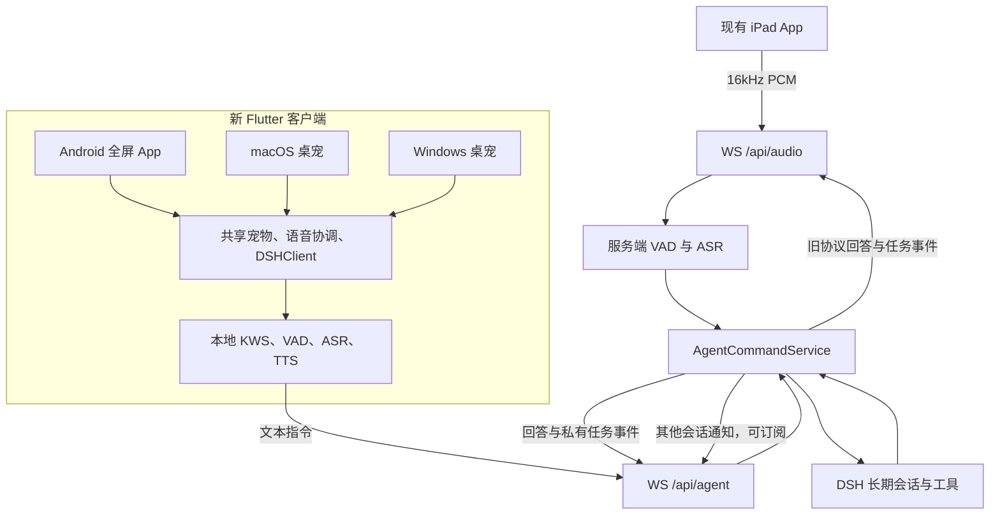

# WhalePet 跨平台架构与实施说明

> 文档状态：目标设计，尚未表示相关代码已经实现  
> 编写日期：2026-11-15  
> 当前基线：iPad App v1.2.6，`whalepet-dsh-bridge` 0.3.0  
> 目标平台：保留现有 iPadOS App，新增 Android App、macOS 桌宠、Windows 桌宠

## 1. 文档目的

本文用于指导后续软件开发，重点回答以下问题：

1. 现有 iPad 项目哪些代码保留、哪些逻辑移植、哪些部分重写。
2. Android、macOS、Windows 如何共享宠物、动画、语音协调和网络代码。
3. 如何把唤醒、VAD、ASR、TTS 从服务端链路中拆出，落到新客户端本地。
4. DSH 插件如何同时支持旧 iPad 音频协议和新客户端文本协议。
5. 多设备同时在线时，如何路由回答、任务事件、断线补发和全局通知。
6. 如何分阶段实施并验证，而不是一次性重写整个项目。

本文不展开 Live2D、账号系统、云端宠物存档同步和统一神经声线。这些均属于后续扩展，不应阻塞第一版。

---

## 2. 当前架构与主要约束

### 2.1 当前 iPad 链路

当前语音链路为：

```text
AVAudioEngine 采集
  → AVAudioConverter 转为 16kHz PCM16
  → WebSocket /api/audio 持续上传
  → 插件 EnergyVad 切句
  → ctx.speechToText（服务端 SenseVoice）
  → 服务端唤醒词匹配与聆听状态机
  → ctx.sessionController 执行 Agent 任务
  → 返回口语化文本
  → iPad AVSpeechSynthesizer 本地播报
```

相关代码：

- `WhalePet/Voice/VoiceController.swift`
- `WhalePet/Networking/DSHClient.swift`
- `Plugin/whalepet-dsh-bridge/src/server.js`
- `Plugin/whalepet-dsh-bridge/src/vad.js`
- `Plugin/whalepet-dsh-bridge/src/session.js`
- `Plugin/whalepet-dsh-bridge/src/textnorm.js`
- `Plugin/whalepet-dsh-bridge/index.js`

### 2.2 当前设计中应保留的资产

- DSH 会话创建、人格、权限、等待回复和任务提醒逻辑。
- 单一长期宠物会话及断线期间任务继续执行的产品行为。
- 宠物状态、数值衰减、离线结算、本地台词和立绘资源。
- 现有 XCTest 和插件 `node:test` 所表达的行为约束。
- 16kHz、单声道、PCM16 的音频输入约定，以及 20ms 帧、pre-roll、静音判停等经验参数。

### 2.3 当前耦合点

`VoiceController.swift` 同时承担：

- 语音 UI 状态；
- 麦克风权限与采集；
- 音频转码；
- DSH 连接；
- TTS；
- 任务提醒播报；
- 前后台与音频中断处理。

新客户端不能按这个类原样翻译，否则 Android 和桌面端仍会重复平台分支和状态竞争。应拆成“语音协调器 + 可替换平台适配器”。

### 2.4 当前多客户端限制

当前插件有两个需要在新增客户端前处理的事实：

1. `delivery.subscriber` 是单订阅者，新连接会替换结果投递目标。
2. 所有请求通过 `askQueues.get('main')` 串行进入同一个长期宠物会话。

第二点可以作为产品决策保留，第一点必须改成按客户端和请求路由，否则桌面端和手机同时在线时可能收错回答。

---

## 3. 总体技术决策

### 3.1 决策摘要

| 编号 | 决策 |
|---|---|
| D-01 | 现有 iPad App 暂时保留，不让 iPad mini 4 承担本地 KWS/ASR 模型 |
| D-02 | Android、macOS、Windows 新客户端使用 Flutter，共享 Dart 业务代码和宠物渲染 |
| D-03 | Flutter 只共享跨平台部分；窗口、音频、模型推理、系统 TTS 使用原生适配层 |
| D-04 | 新三端默认本地 KWS 唤醒、本地 ASR、本地 TTS，网络只传文本和事件 |
| D-05 | 本地语音统一引擎优先验证 sherpa-onnx；系统 ASR 只作为可选 Provider |
| D-06 | TTS 第一版使用系统能力，不在安装包中强制附带神经 TTS 模型 |
| D-07 | DSH 插件抽取统一 `AgentCommandService`，旧音频和新文本通道共同调用 |
| D-08 | 保留旧 `/api/audio`，新增纯 JSON `/api/agent`，避免破坏 iPad |
| D-09 | 默认所有设备共享一个宠物长期会话，但请求结果按发起设备单播 |
| D-10 | 第一版宠物存档各端本地保存，跨设备存档同步后置 |

### 3.2 为什么选择 Flutter，而不是三端全原生

当前宠物不是复杂 3D 或 Live2D 项目，主要是静态立绘、位移、缩放、旋转、透明度和气泡。Flutter 足以覆盖这些表现，并能共享：

- 宠物状态与数值；
- 动画状态映射；
- 语音协调器；
- DSH 协议客户端；
- 设置、日志和存档模型；
- Android 与桌面端的大部分 UI。

不选择三端全原生的原因是长期维护成本。不选择 Electron/Tauri 作为统一方案的原因是 Android 仍需另一套客户端，最终会形成两套 UI 技术栈。

如果未来只做 macOS、不做 Windows，原生 AppKit + SpriteKit 可以复用更多现有 Swift 代码；但这不是当前三端目标下的优先路线。

### 3.3 Flutter 不等于“所有代码共享”

以下部分仍必须平台化：

- Android 麦克风、音频焦点、权限和前台服务；
- macOS `NSWindow` 层级、全空间显示、点击穿透和菜单栏；
- Windows 透明窗口、托盘、多显示器 DPI 和点击穿透；
- sherpa-onnx 原生库加载与模型文件管理；
- 各平台安全存储和系统 TTS。

---

## 4. 目标架构



核心边界：

> 客户端负责“听到什么、何时唤醒、怎样播报”；服务端负责“这句话要执行什么、任务进展如何”。

---

## 5. 推荐目录结构

为了控制第一版复杂度，不急于拆成很多 Dart package。先使用一个 Flutter 工程，内部保持模块边界：

```text
ipadpet/
├── WhalePet/                       # 现有 iPad App，继续维护
├── Plugin/
│   └── whalepet-dsh-bridge/
│       ├── index.js                # DSH 服务装配、人格、会话生命周期
│       └── src/
│           ├── server.js           # HTTP 与 Upgrade 路由、鉴权
│           ├── legacy-audio.js     # 从现 VoicePipeline 拆出的旧音频通道
│           ├── agent-channel.js    # 新 /api/agent JSON 通道
│           ├── agent-service.js    # 统一命令执行、排队、回复提取
│           ├── client-hub.js       # 客户端注册、单播、广播、离线缓存
│           ├── vad.js              # 旧音频通道继续使用
│           ├── session.js          # 旧音频通道继续使用
│           └── textnorm.js         # 旧音频通道及共享测试样本
├── Clients/
│   └── whalepet_flutter/
│       ├── android/
│       ├── macos/
│       ├── windows/
│       ├── assets/
│       │   ├── pet/                # 复用现有立绘
│       │   └── effects/
│       ├── lib/
│       │   ├── main.dart
│       │   ├── core/
│       │   │   ├── pet/
│       │   │   ├── voice/
│       │   │   ├── agent/
│       │   │   ├── storage/
│       │   │   └── config/
│       │   ├── platform/
│       │   │   ├── voice_engine/
│       │   │   ├── speech_output/
│       │   │   ├── desktop_window/
│       │   │   └── secure_storage/
│       │   └── ui/
│       │       ├── pet/
│       │       ├── mobile_scene/
│       │       ├── desktop_pet/
│       │       └── settings/
│       └── test/
└── docs/
    └── CROSS_PLATFORM.md
```

依赖规则：

```text
UI → core 接口 → platform 实现
core 不得 import Flutter 平台 SDK 或原生窗口代码
platform 不得反向修改 UI widget
网络事件、语音事件统一使用不可变模型
```

可以使用 Riverpod 做依赖注入和 UI 状态装配，但 `core` 中的宠物逻辑、语音状态机和协议解析应保持纯 Dart，不依赖 Riverpod。

---

## 6. 宠物核心与渲染设计

### 6.1 状态模型

沿用现有状态：

```text
idle / walk / swim / sleep
happy / eat / play / drag
listening / thinking / speaking
```

约束：

- `drag`、`listening`、`thinking`、`speaking` 不被随机调度打断。
- 自主状态只在 `idle / walk / swim / sleep` 中选择。
- 语音状态由 `VoiceSessionCoordinator` 进入和退出。
- 随机源必须注入，不要在枚举属性里直接调用全局随机数，以便重放测试。

### 6.2 数值规则

第一版保持现有数值，不在跨平台重写时顺便调平衡：

| 项目 | 规则 |
|---|---|
| 饱食 | 清醒和睡眠均按约 4 小时从 100 降至 0 |
| 心情 | 约 6 小时从 100 降至 0；饱食低于 25 时双倍衰减 |
| 精力 | 非睡眠约 5 小时耗尽；睡眠每秒恢复 1.2 |
| 离线结算 | 单次最多结算 6 小时 |
| 投喂 | 饱食 +22、心情 +6；睡眠时拒绝 |
| 摸头 | 默认心情 +10 |
| 玩耍 | 心情 +8、精力 -5；睡眠时拒绝 |

帧循环中的 `dt` 可按现有实现限制到最多 0.1 秒；离线时间不能通过逐帧补偿，必须单独执行 `settleOffline()`。

### 6.3 移动和桌面渲染的关键差异

Android 使用与 iPad 类似的全屏场景：

- 宠物在屏幕坐标系内移动；
- 背景、海底地面和 HUD 保留；
- 单 `Ticker` 驱动动画，不为每个部件创建独立计时器。

macOS 和 Windows 不建议使用“覆盖整个屏幕的透明大窗口”。第一版采用：

> **操作系统窗口本身就是宠物，桌宠移动就是移动窗口。**

理由：

- 避免全屏透明窗口拦截其他软件输入；
- 降低透明窗口渲染面积和 GPU 占用；
- 更容易实现置顶、拖拽、托盘退出和多显示器约束。

桌面窗口建议：

- 透明、无边框、置顶、默认不出现在任务栏；
- 窗口内包含宠物和气泡的预留区域；
- 鼠标拖拽调用原生窗口移动；
- `walk/swim` 通过桌面场景控制器更新窗口位置；
- 移动目标限制在当前显示器 work area，而不是完整屏幕边界；
- 窗口位置更新限制到约 30fps，避免高频调用原生窗口 API；
- 提供“鼠标穿透”显式开关，默认关闭，防止用户无法再次选中宠物。

共享的是 `PetSprite`、状态动画和气泡组件；移动端与桌面端分别实现场景控制器。

---

## 7. 本地语音架构

### 7.1 职责拆分

```text
VoiceSessionCoordinator
├── VoiceEngineAdapter
│   ├── 原生音频采集与重采样
│   ├── KWS 唤醒
│   ├── VAD 切句
│   └── ASR 识别
├── SpeechOutputAdapter
│   └── 系统 TTS 与播放结束回调
├── AgentGateway
│   └── 文本命令、响应、任务事件
└── SpeechQueue
    └── 去重、排队、打断和播报策略
```

`VoiceSessionCoordinator` 是客户端唯一语音状态所有者。服务端不再维护新客户端的 `waiting/listening` 状态。

### 7.2 推荐语音状态机

```text
disabled
preparing
waitingWake
listening
recognizing
thinking
speaking
error
```

主要转换：

| 当前状态 | 事件 | 下一状态 | 动作 |
|---|---|---|---|
| `disabled` | 用户开启语音 | `preparing` | 检查权限、模型和原生引擎 |
| `preparing` | 初始化成功 | `waitingWake` | 启动低功耗 KWS |
| `preparing` | 失败 | `error` | 给出可恢复原因 |
| `waitingWake` | 本地唤醒，无唤醒应答 | `listening` | 立即启动指令识别 |
| `waitingWake` | 本地唤醒，需要先说“我在” | `speaking(resume=listening)` | 暂停采集，唤醒应答后进入聆听 |
| `waitingWake` | 点击麦克风 | `listening` | 跳过 KWS |
| `listening` | 收到中间识别文本 | `listening` | 更新气泡，不发送命令 |
| `listening` | VAD 判停，等待最终 ASR | `recognizing` | 停止本轮采集，保留聆听超时保护 |
| `recognizing` | 最终识别文本有效 | `thinking` | 发送 `command` |
| `recognizing` | 空文本或可恢复识别失败 | `listening` 或 `waitingWake` | 未超时允许重说，否则回待唤醒 |
| `listening` | 聆听超时 | `waitingWake` | 清理音频缓冲 |
| `thinking` | 收到最终响应 | `speaking(resume=waitingWake)` | 上屏并排队 TTS |
| `thinking` | 可重试错误 | `error` 或 `waitingWake` | 保留明确错误信息 |
| `speaking` | TTS 完成 | `resumeAfterSpeech` 指定的状态 | 清空旧音频，延迟恢复 KWS |
| `speaking` | 用户点击麦克风 | `listening` | 停止 TTS，清空待播队列后开始新指令 |
| 任意工作状态 | 用户停止 | `disabled` | 停止采集、识别和播报 |

`speaking` 必须携带 `resumeAfterSpeech`，不能固定回到 `waitingWake`：普通回答播完回待唤醒，唤醒应答播完则应进入聆听。第一阶段采用“先唤醒应答、再听指令”；第二阶段支持一句话带命令时，命中唤醒后不先播应答，而是按 7.7 节直接识别余量。

每次启动、停止或重连都增加 `generation`。所有异步回调必须携带 generation，旧 generation 的迟到事件直接丢弃。这对应现有 iOS 代码已经解决过的“双 WebSocket、双音频引擎”问题。

### 7.3 音频数据约定

| 项目 | 默认值 |
|---|---|
| 采样率 | 16000Hz |
| 声道 | 单声道 |
| 样本格式 | 小端 Int16 PCM |
| 分析帧长 | 20ms |
| 每帧样本数 | 320 |
| 每帧字节数 | 640 |
| pre-roll | 300ms |
| 尾部静音判停 | 700ms |
| 单条指令最长 | 20s |
| 唤醒后聆听超时 | 10s |

如果设备采集是 44.1kHz 或 48kHz，应在原生音频层重采样后再进入 KWS/ASR。Dart 层不应接收持续 PCM 流。

### 7.4 不让 PCM 穿越 Flutter MethodChannel

20ms 一帧意味着每秒 50 次回调。持续把 PCM 从原生层传到 Dart 会产生不必要的拷贝和平台通道压力。

推荐做法：

- 原生层完成采集、重采样、环形缓冲、KWS、VAD 和 ASR；
- Flutter 只接收 `wake / partialTranscript / finalTranscript / error`；
- Dart 只发送初始化、开始、停止、手动聆听等控制命令。

这也是 `VoiceEngineAdapter` 存在的主要原因。

### 7.5 Dart 侧接口建议

```dart
abstract interface class VoiceEngineAdapter {
  Stream<VoiceEngineEvent> get events();

  Future<void> initialize(VoiceEngineConfig config);
  Future<void> startWakeListening();
  Future<void> startManualListening();
  Future<void> stopListening();
  Future<void> dispose();
}

abstract interface class SpeechOutputAdapter {
  Stream<SpeechOutputEvent> get events();

  Future<void> initialize();
  Future<void> speak(String utteranceId, String text);
  Future<void> stop();
  Future<void> dispose();
}

abstract interface class AgentGateway {
  Stream<AgentEvent> get events();

  Future<void> connect();
  Future<void> sendCommand(AgentCommand command);
  Future<void> cancel(String requestId);
  Future<void> disconnect();
}
```

事件模型至少包含：

```text
VoiceEngineEvent:
- engineReady
- wakeDetected(keyword, timestamp)
- partialTranscript(text)
- finalTranscript(text)
- recognitionError(code, message, retryable)
- captureError(code, message)

SpeechOutputEvent:
- started(utteranceId)
- finished(utteranceId)
- cancelled(utteranceId)
- failed(utteranceId, message)
```

### 7.6 KWS、VAD、ASR 的运行策略

待机时：

```text
麦克风 → 环形缓冲 → KWS
```

唤醒后：

```text
麦克风 → VAD/流式 ASR → partial/final transcript
```

回答时：

```text
停止或暂停采集 → 清空旧识别状态 → 系统 TTS
```

不要从 App 启动开始一直运行完整 ASR。KWS 是低功耗守门器，ASR 只在唤醒或手动点击后运行。

### 7.7 两阶段实现“一句话带命令”

第一阶段只支持：

```text
“小鲸小鲸” → “我在” → 用户说指令
```

第二阶段再支持：

```text
“小鲸小鲸，帮我查一下明天的安排”
```

实现要求：

1. 保留至少 300～500ms 的音频环形缓冲。
2. KWS 命中后，立即把后续音频交给 ASR，不要等唤醒应答播放完再采集。
3. 如果使用整段 ASR，识别结果仍包含唤醒词时，复用现有 `WakeMatcher` 的规则剥离句首唤醒词及别名。
4. 句尾判停后，若唤醒词后没有有效命令，再播放“我在”并保持 10 秒聆听。
5. 若已有有效命令，不播放“我在”，直接发送命令。

唤醒词变更会改变 KWS keywords 文件或 token 配置，必须重新生成并安全重载 KWS，不能只改 UI 设置文本。

### 7.8 TTS 防自触发与播报队列

第一版采用简单可靠的闭麦方案：

1. TTS 开始前暂停 KWS/ASR 采集。
2. 清空 VAD、ASR 和 pre-roll 中的旧数据。
3. TTS 完成后等待约 150～300ms，再恢复采集。
4. 恢复时旧 TTS 回调不得改变新一轮状态。

`SpeechQueue` 至少支持：

- 按 `eventId/utteranceId` 去重；
- 正式回答优先于普通任务提醒；
- `finished` 后紧跟正式回答时，不重复播“做完了”；
- 新错误提醒是否打断当前播报由明确策略决定，不能隐式互相覆盖；
- 手动停止时清空待播内容。

桌面端后续可启用 AEC 和 barge-in，但不应作为第一版依赖。

### 7.9 sherpa-onnx 接入建议

优先验证以下组合：

- KWS：中英文轻量 Zipformer KWS 模型；
- VAD：Silero VAD 或现有能量 VAD 的本地等价实现；
- ASR：中文/中英流式 Zipformer，用于指令识别和中间结果；
- 备用 ASR：SenseVoice int8 整段识别，用于对比准确率和性能。

注意：

- 具体模型必须经过目标设备实测后再锁定，不在代码里写死下载地址。
- KWS 的 boosting score 和 trigger threshold 没有跨模型通用最佳值，应做成模型配置。
- sherpa-onnx 通过 Android Kotlin/Java、macOS Swift/C++、Windows C++ 等原生适配接入。
- Flutter 插件只作为集成选项，不作为架构前提。
- 系统 ASR 可以是额外 Provider，但“系统提供语音识别”不等于“必然离线”。

### 7.10 模型下载与版本管理

不要简单把所有模型直接打进安装包。建议维护本地模型清单：

```json
{
  "model_set_version": "zh-command-1",
  "engine_abi": "sherpa-onnx-compatible-1",
  "models": [
    {
      "id": "kws-zh-en-light",
      "version": "1",
      "size": 0,
      "sha256": "填写真实摘要",
      "files": ["model.onnx", "tokens.txt", "keywords.txt"]
    },
    {
      "id": "asr-zh-streaming",
      "version": "1",
      "size": 0,
      "sha256": "填写真实摘要",
      "files": ["model.onnx", "tokens.txt"]
    }
  ]
}
```

要求：

- 下载到临时文件，校验大小和 SHA-256 后原子替换；
- 记录模型许可证和来源；
- KWS 与 ASR 可独立更新；
- 模型初始化失败时允许文本输入和本地宠物继续工作；
- 模型更新不得在识别过程中直接覆盖正在使用的文件；
- 保留模型集合版本与原生引擎 ABI 的兼容检查。

---

## 8. 新 Agent 文本协议

### 8.1 兼容原则

以下旧接口继续保留：

- `GET /api/health`
- `POST /api/chat`
- `WS /api/audio`

新增：

- `WS /api/agent`

所有接口继续使用现有 Bearer 鉴权。新协议字段统一使用 `snake_case`，与旧协议保持一致。

### 8.2 标识符定义

| 字段 | 含义 |
|---|---|
| `client_id` | 每次安装生成并持久化的设备客户端 ID |
| `conversation_id` | 宠物长期会话 ID，默认所有设备使用 `whalepet-main` |
| `request_id` | 一次用户命令的唯一 ID，由客户端生成 |
| `event_id` | 服务端事件的唯一 ID，用于去重和补发 |
| `task_id` | DSH 任务或本轮执行 ID；无法取得时可与 request_id 关联 |

不要把设备 ID、DSH 会话 ID 和请求 ID 混为一个 `session_id`。

### 8.3 握手

客户端：

```json
{
  "type": "hello",
  "protocol": 2,
  "client_id": "android-7f2c91a0",
  "conversation_id": "whalepet-main",
  "device_kind": "android",
  "capabilities": ["local-wake", "local-asr", "local-tts"],
  "subscriptions": {
    "announcements": true
  },
  "last_received_event_id": null
}
```

服务端：

```json
{
  "type": "ready",
  "protocol": 2,
  "client_id": "android-7f2c91a0",
  "conversation_id": "whalepet-main",
  "agent_ready": true,
  "server_time": "2026-11-15T12:00:00Z"
}
```

`agent_ready` 不应依赖服务端 ASR 是否可用。

### 8.4 发送命令

```json
{
  "type": "command",
  "request_id": "req-01JCDEFGHJKMNPQRSTVWXYZ",
  "client_id": "android-7f2c91a0",
  "conversation_id": "whalepet-main",
  "text": "帮我总结一下今天的工作",
  "source": "voice"
}
```

规则：

- 同一客户端第一版同时只允许一个活动语音命令。
- `request_id` 必须持久化到本轮完成，重连后重复发送时服务端不得重复 `prompt()`。
- 服务端为 `request_id` 建立幂等记录，至少保留到结果可靠投递或超过配置的 TTL。
- 调用 DSH 时使用该 `request_id` 派生稳定的 prompt requestId，不能像当前旧实现一样在重试时重新生成随机 UUID。
- 命令进入共享会话队列时可以发送 `task queued`，避免用户误以为没有响应。

ID 建议限制为 `[A-Za-z0-9_-]`、1～80 字符；命令文本去除首尾空白后限制为非空且不超过 16000 字符。单条 JSON 控制消息也应有大小上限，不能把任意长文本或无界 ID 写入内存索引。

### 8.5 私有任务事件

```json
{
  "type": "task",
  "event_id": "evt-000123",
  "request_id": "req-01JCDEFGHJKMNPQRSTVWXYZ",
  "origin_client_id": "android-7f2c91a0",
  "task_id": "whalepet-main:req-01JCDEFGHJKMNPQRSTVWXYZ",
  "state": "started",
  "text": "开始执行，我这就去办"
}
```

`state` 第一版支持：

```text
queued / started / approval / interrupted / finished / failed
```

私有任务事件只发送给 `origin_client_id`，不能广播给所有设备。

### 8.6 最终回答

```json
{
  "type": "response",
  "event_id": "evt-000124",
  "request_id": "req-01JCDEFGHJKMNPQRSTVWXYZ",
  "origin_client_id": "android-7f2c91a0",
  "display_text": "完整回答，可以保留 **Markdown**。",
  "speech_text": "适合直接播报的回答。",
  "final": true
}
```

服务端应先提取原始 assistant 文本，再分别生成：

- `display_text`：用于桌面聊天面板或历史记录；
- `speech_text`：通过现有 `toSpeechText()` 清理后用于 TTS。

旧 `/api/audio` 继续只取 `speech_text`，因此 iPad 行为不变。

同一请求先发送 `response`，再发送 `task finished`。客户端收到 `response` 后就展示并播报正式回答；随后的 `finished` 只更新任务状态，不再重复播“做完了”。

### 8.7 全局通知

其他 DSH 会话的开始、完成、授权提醒使用独立事件，不伪装成宠物命令回答：

```json
{
  "type": "announcement",
  "event_id": "evt-000125",
  "scope": "global",
  "state": "finished",
  "display_text": "做完了：整理备课资料",
  "speech_text": "做完了：整理备课资料"
}
```

只有握手中订阅 `announcements` 的客户端接收。普通公告默认仅在线投递，离线后不补播，避免重连时集中念出一串过期通知；宠物自己的会话和 subagent 会话不重复生成全局通知。

### 8.8 错误与取消

错误：

```json
{
  "type": "error",
  "request_id": "req-01JCDEFGHJKMNPQRSTVWXYZ",
  "code": "agent_timeout",
  "message": "DSH 响应超时",
  "retryable": true
}
```

取消：

```json
{
  "type": "cancel",
  "request_id": "req-01JCDEFGHJKMNPQRSTVWXYZ",
  "client_id": "android-7f2c91a0"
}
```

必须区分：

- 停止本地等待和本地 TTS；
- 真正停止 DSH Agent 执行。

在确认 DSH 有可靠停止 API 之前，协议只能承诺“桥接层停止等待并忽略后续展示”，不能向用户虚假显示远程任务已终止。

### 8.9 断线补发与去重

第一版至少保证：

- 断线不主动终止正在运行的 Agent；
- 每个客户端分别缓存未完成请求的最终结果；
- 每个客户端分别缓存待处理授权提醒；
- `thinking` 等瞬时心跳不需要补发；
- 客户端按 `event_id` 去重；
- 客户端在 `hello` 中上报 `last_received_event_id`；服务端先回 `ready`，再补发仍然有效的可靠事件；
- 重连后补发最终结果、未完成授权和仍在运行状态；
- 缓存设置条数和 TTL 上限，不能无限增长。

可以实现每客户端最多 100 条可靠事件、默认 24 小时 TTL，并只缓存 `response / approval` 等可靠事件。`announcement` 默认不缓存，确需离线公告时应做成独立订阅选项。

### 8.10 客户端重连规则

沿用现有 iOS 已验证的基本策略：

- WebSocket 前先检查 `/api/health`；
- 401/403 属于配置错误，不自动重试；
- 网络失败按 1、2、4、8、16、30 秒退避，30 秒封顶；
- 收到 `ready` 后重置重连次数；
- WS ping 超时应关闭旧连接并使旧连接事件失效；
- 重连不得重复启动 KWS/ASR，本地音频生命周期与网络生命周期分开；
- 只有处于“已发送但结果未知”的命令才允许带原 `request_id` 重试，不能生成新 ID 后再次提交同一句话。

---

## 9. DSH 插件重构方式

### 9.1 抽取 AgentCommandService

建议接口：

```js
class AgentCommandService {
  async execute({
    requestId,
    conversationId,
    originClientId,
    text,
    signal,
    notify,
  }) {
    // 返回 { displayText, speechText }
  }
}
```

它负责：

- 确保长期会话存在；
- 权限预设与人格注入；
- 按 `conversationId` 串行排队；
- 调用 `sessionController.prompt()`；
- 等待、提取原始回复与口语文本；
- 处理 `input-required`；
- 处理会话删除后的重建；
- 空闲归档。

旧音频通道和新文本通道都不得各自再实现一套上述逻辑。

### 9.2 ClientHub

至少维护以下索引：

```text
ClientHub
├── clients: Map<clientId, ClientRecord>
├── requests: Map<requestId, RequestRecord>
└── conversations: Map<conversationId, ConversationRecord>
```

职责：

- 同一 `client_id` 可以有重连后的新连接，但旧连接必须失效；
- 私有回答根据 `requestId → originClientId` 投递；
- 全局通知只向订阅者广播；
- 离线缓存按客户端隔离；
- 断线只移除在线连接，不删除请求执行状态。

### 9.3 共享会话与排队

第一版保留“所有设备共享一个宠物人格和长期记忆”的产品行为：

```text
whalepet-main
  → 一个 DSH 长期会话
  → 一个命令队列
```

代价是某个设备的长任务会阻塞其他设备的新命令。因此：

- 必须发送 `queued` 状态；
- UI 显示“还有一个任务在处理”；
- 不要在客户端盲目超时后重复提交；
- 后续如需并行，再引入不同 `conversation_id`，而不是绕过队列向同一会话并发 prompt。

### 9.4 健康检查

兼容旧字段并增加能力信息，例如：

```json
{
  "ok": true,
  "version": "0.4.0",
  "agent": {
    "ready": true
  },
  "asr": true,
  "model": "sensevoice-local/ready",
  "protocols": ["audio-v1", "agent-v2"]
}
```

新客户端只要求 `agent.ready == true`。旧 iPad 仍可检查 `asr`。

需要注意：当前 `index.js` 的静态 `inject` 仍包含 `speechToText`。第一阶段只要求“服务端 ASR 模型未就绪或识别失败时，新文本通道仍可用”，不代表已经移除 Host 服务依赖。若后续要在完全没有 `speechToText` 的 DSH profile 中运行，应根据 Host 支持情况选择：

1. 改成可选服务注入，仅旧 `/api/audio` 在使用时要求 ASR；或
2. 把旧音频兼容层拆成独立 bundle，新 Agent bundle 不再注入 `speechToText`。

在 Host 可选服务机制未确认前，不要直接删掉现有 inject，否则可能导致整个插件无法加载。

---

## 10. 各平台实施要点

### 10.1 Android

第一版形态：前台全屏 App，不做系统悬浮窗和后台常听。

实现要点：

- `AudioRecord` 采集 PCM，优先直接请求 16kHz 单声道；
- 根据设备支持情况选择 `VOICE_RECOGNITION` 或 `MIC`，实测回声与噪声表现；
- 申请 `RECORD_AUDIO`，处理拒绝、永久拒绝和音频焦点；
- 退后台默认停止采集，回来按用户设置恢复；
- 来电、其他 App 抢占音频时进入暂停或错误态；
- 系统 TTS 使用 Android `TextToSpeech`，等待 utterance 完成回调后再恢复 KWS；
- 模型放在 App 私有文件目录，下载后校验；
- 服务地址可普通存储，令牌使用 Android Keystore 加密存储。

后续悬浮桌宠版本再增加：

- `SYSTEM_ALERT_WINDOW`；
- 麦克风类型前台服务；
- 可见的常驻通知与麦克风状态；
- 后台启动和 Android 版本限制处理。

这些不应提前混入第一版。

> **落地状态（2026-11-16）**：阶段 C 第 1~4 步已实现。第 3 步的「本地 KWS 常驻唤醒」
> 目前仍用「连续系统识别 + 唤醒词文本匹配」顶着（系统识别没有关键字语法），
> 接 sherpa-onnx 时只换 `VoiceEngineAdapter` 实现，Dart 侧不动；
> 第 4 步的音频焦点 / 来电 / 前后台恢复已落地：焦点丢失与来电进入**可恢复**的
> error 态，恢复后自动回到待唤醒，文本对话全程不受影响。
> 第 5 步（模型下载与校验）未开始。详见
> [`Clients/whalepet_flutter/README.md`](../Clients/whalepet_flutter/README.md)。

### 10.2 macOS

窗口：

- Flutter 负责宠物和气泡绘制；
- 原生 Swift/AppKit 设置 `NSWindow` 透明、无边框和窗口层级；
- 按需设置全空间显示、是否出现在 Dock、鼠标穿透；
- 提供菜单栏退出、语音开关、置顶开关和设置入口；
- 多显示器变化后重新约束窗口位置。

语音：

- 请求麦克风和必要的语音识别权限；
- 默认使用内置 sherpa-onnx，不依赖 Apple 在线识别；
- 系统 TTS 使用 `AVSpeechSynthesizer`；
- 如增加 `SFSpeechRecognizer` Provider，必须检查 `supportsOnDeviceRecognition`，并设置 `requiresOnDeviceRecognition`；
- 发布时处理签名、公证和 App Sandbox 麦克风 entitlement。

> **落地状态（2026-11-16）**：窗口与系统 TTS 已实现；本地语音分两段——
> **唤醒**用 sherpa-onnx 本地 KWS，**指令识别**用系统 `SFSpeechRecognizer`
> 本机识别。
>
> - 唤醒：常驻子进程 `tool/whalepet_kws.cpp`（sherpa-onnx KWS，中文拼音建模），
>   采集在 `macos/Runner/VoiceEngine.swift`（AVAudioEngine）→ 重采样 16kHz
>   单声道 → 管道喂给子进程；命中后经 `whalepet/voice` 通道推
>   `{"type":"wake"}` 事件，Dart 适配层转成文本交给
>   `core/voice/voice_event_router.dart` 复核（用户换了唤醒词也不会误触发）。
> - 识别：指令识别仍走系统识别器（`requiresOnDeviceRecognition`，本机完成，
>   PCM 不进 Dart）。
> - 载荷：运行时动态库 + KWS 模型约 40MB，**不入库**；由
>   `tool/fetch_sherpa_onnx.sh` 在出包时拉取，Xcode 的「Copy KWS Payload」
>   阶段拷进 App 包的 `Resources/kws/`，用户拿到的 App 离线可用。
> - 退化路径：没有载荷 / 唤醒词不在拼音表 / 子进程起不来 → 自动退回
>   「系统识别 + 唤醒词文本匹配」，功能不丢，只是待机期更费电。
> - 触发阈值 0.08 是按 TTS 合成音频标定的初值，真机复验时按实际误触发率再调。
>
> 「多显示器变化后重新约束窗口位置」也已落地（原生
> `didChangeScreenParameters` → `screensChanged` → 重读工作区并夹回）。
> 详见
> [`Clients/whalepet_flutter/README.md`](../Clients/whalepet_flutter/README.md)。

### 10.3 Windows

第一版优先支持 Windows 10/11 x64，其他架构后补。

窗口：

- Flutter 透明窗口配合原生 Win32 适配；
- 处理置顶、无任务栏图标、托盘和开机启动；
- 点击穿透通过原生窗口样式实现，并提供可恢复入口；
- 正确处理 Per-Monitor DPI、多显示器和工作区；
- 原生窗口移动与 Dart 场景坐标不得互相覆盖。

语音：

- 原生音频采集后统一为 16kHz PCM16；
- sherpa-onnx 使用 Windows 原生库；
- 系统 TTS 可使用 Windows 语音合成 API；
- 安装包包含所需原生运行库，并验证干净机器上的加载路径。

> **落地情况（2026-11-16）**
>
> | §10.3 要求 | 状态 | 实现 |
> |---|---|---|
> | 透明窗口 + 原生 Win32 适配 | ✅ | `WS_EX_LAYERED` + `DwmExtendFrameIntoClientArea(-1)`，无边框、不进任务栏 |
> | 置顶 / 无任务栏图标 | ✅ | `HWND_TOPMOST` + `WS_EX_TOOLWINDOW` |
> | **托盘** | ✅ | runner 里 `Shell_NotifyIcon`（`tray_icon.cpp`）：右键菜单（显示/隐藏、语音开关、设置、退出）、左键双击切显隐；Explorer 重启后按 `WM_TASKBARCREATED` 补回；菜单动作经 `whalepet/desktop` 通道给 Dart |
> | **开机启动** | ✅ | `HKCU\...\CurrentVersion\Run` 注册表项，`dart:ffi` 直连 advapi32（不需管理员权限）；便携包换目录后自动刷新路径 |
> | 点击穿透 + 可恢复入口 | ✅ | `WS_EX_TRANSPARENT`，命中测试用全局光标自动恢复 |
> | **Per-Monitor DPI / 多显示器 / 工作区** | ✅ | 清单已声明 `PerMonitorV2`；runner 监听 `WM_DISPLAYCHANGE` / `WM_SETTINGCHANGE` / `WM_DPICHANGED` → Dart 刷新 DPI 比例并把窗口夹回工作区 |
> | 原生音频采集 16k PCM16 | ✅ | SAPI5 引擎内完成，PCM 不穿 Dart（§7.4） |
> | **sherpa-onnx Windows 原生库** | ⛔ 阻塞 | 运行时 DLL 与 ASR 模型已可取（npm 官方包 / HF 镜像），但官方 `c-api.h` 头文件只在 GitHub Releases（当前网络不可达），缺它无法编译 Provider 或写 FFI 绑定；依赖脚本见 `Clients/whalepet_flutter/tool/fetch_sherpa_onnx_windows.py` |
> | 系统 TTS | ✅ | SAPI5（`System.Speech`），中文音色系统自带 |
> | 安装包含原生运行库 + 干净机验证 | ✅ | `tool/package_release.py` 按 app-local 附带 VC 运行库，缺必需项直接失败 |

---

## 11. 设置、存档与安全

### 11.1 本地宠物存档

建议新跨平台格式显式版本化：

```json
{
  "schema_version": 1,
  "vitals": {
    "satiety": 80.0,
    "mood": 80.0,
    "energy": 90.0
  },
  "last_tick_utc": "2026-11-15T12:00:00Z",
  "pet_name": "小鲸",
  "total_feeds": 0,
  "total_pets": 0,
  "born_at_utc": "2026-11-15T08:00:00Z"
}
```

要求：

- 时间格式明确为 UTC ISO-8601，不依赖各语言默认 Date JSON 编码；
- 原子写入；
- 损坏存档先备份再恢复默认值；
- 15 秒节流保存，退出或退后台立即保存；
- 桌面窗口位置、语音设置放在独立设置文件，不混入宠物数值存档。

### 11.2 服务器配置与令牌

- 服务地址、语音开关可以普通本地存储；
- Bearer 令牌必须进入 Keychain、Android Keystore 或 Windows DPAPI 等安全存储；
- 日志不得输出完整令牌和原始认证头；
- 默认不保存原始麦克风音频；
- 识别文本和 Agent 日志应提供本地清理能力；
- 明文 HTTP 仍只用于内网或可信 Overlay 网络，不直接暴露公网。

### 11.3 语音配置同步

本地唤醒词与现有 DSH 设置可能不一致。建议 `ready` 后下发带版本的语音配置：

```json
{
  "type": "voice_config",
  "revision": 3,
  "wake_phrase": "小鲸小鲸",
  "wake_aliases": ["小鲸小鲸", "小金小金"],
  "wake_ack": "我在",
  "listen_timeout_ms": 10000
}
```

客户端规则：

- 无网络时使用最近缓存配置；
- revision 不变不重建模型；
- revision 变化时重新生成 KWS keywords/token 配置；
- 在安全点重启 KWS，不能一边识别一边覆盖引擎；
- KWS 不支持的自定义词要明确报错，不能假装已生效。

---

## 12. 测试与验收

### 12.1 Dart 核心测试

将现有 XCTest 的行为迁移为 Dart 测试：

- 数值衰减、上下限和 6 小时离线结算；
- 睡眠时不能投喂和玩耍；
- 拖拽和语音状态不被随机调度覆盖；
- 存档往返、损坏恢复和 schema 迁移；
- 固定随机源时状态序列可重放；
- 旧 generation 的语音回调被忽略。

### 12.2 语音协调器测试

使用假的 VoiceEngine、SpeechOutput 和 AgentGateway，覆盖：

1. 唤醒 → 指令 → 思考 → 回答 → 恢复唤醒。
2. 手动麦克风跳过唤醒。
3. 空识别和 10 秒聆听超时。
4. TTS 期间不接收自己的音频事件。
5. 多条任务提醒不会重复播报。
6. `finished + response` 不重复念完成提醒。
7. 取消后迟到的 ASR、DSH 和 TTS 回调均无效。
8. 断线重连补发不会重复执行或重复播报。
9. 服务端 ASR 不可用时，本地语音命令仍能进入 Agent。
10. DSH 不可用时，宠物互动和本地存档仍可使用。

### 12.3 插件契约测试

继续使用 `node:test`，增加：

- 旧 `/api/audio` 回归测试不减少；
- `/api/agent` 鉴权、握手、命令、回答和取消；
- 两个客户端同时在线，回答只到发起端；
- 全局通知只到订阅端；
- 同一 `request_id` 重试只产生一次 DSH prompt；
- A 断线时，B 仍能收到自己的回答；
- A 重连后收到自己的缓存结果，收不到 B 的私有结果；
- 共享会话排队顺序稳定；
- 服务端 ASR 模型未就绪或识别失败时，文本通道仍健康。

### 12.4 真实语音测试集

建立固定音频样本，不只靠开发者现场试几句：

- 不同说话人、距离、音量和语速；
- 安静房间、风扇、音乐、键盘和多人谈话；
- 唤醒词、别名、相似但不应唤醒的词；
- 唤醒词单独说、一句话带命令、口音和中英混合；
- TTS 播报期间的环境录音。

每次更换 KWS/ASR 模型或阈值，都记录：

- 唤醒成功率；
- 误唤醒次数/小时；
- 指令识别准确率；
- 唤醒到开始聆听的延迟；
- 说完到最终文本的延迟；
- CPU、内存和长时间运行温度。

发布前至少验证：连续多次 TTS 不自触发、长时间待唤醒不泄漏、锁屏/切后台行为符合平台设置。

---

## 13. 分阶段实施计划

### 阶段 A：服务端解耦，不改变 iPad 行为

交付：

- 抽取 `AgentCommandService`；
- 新增 `ClientHub` 和 `/api/agent`；
- 分离 `display_text` 与 `speech_text`；
- 增加多客户端和幂等测试；
- 保持现有 `/api/audio` 全部测试通过。

验收：iPad 原有功能不变，新文本通道可以用测试客户端完成命令和断线补发。

### 阶段 B：Flutter 宠物核心

交付：

- Dart 宠物状态、数值、存档和动画；
- Android 全屏场景；
- 立绘、气泡、投喂、摸头、玩耍和设置；
- Dart `AgentGateway` 与文本聊天。

验收：不使用语音也能完成 Android 宠物互动和文本 Agent 对话。

### 阶段 C：Android 本地语音垂直闭环

按顺序交付：

1. 系统 TTS；
2. 手动点击采集与本地 ASR；
3. 本地 KWS 常驻唤醒；
4. 聆听超时、取消、音频焦点和前后台处理；
5. 模型下载、校验和错误恢复。

验收：完成“本地唤醒 → 本地识别 → DSH 执行 → 本地播报”，原始音频不上传。

### 阶段 D：macOS 桌宠

交付：

- 复用 Flutter 宠物和语音模块；
- 小尺寸透明置顶窗口；
- AppKit 窗口适配、菜单栏、拖拽和多显示器；
- 安全存储、签名和打包。

验收：桌宠可移动、互动、语音对话，关闭窗口后仍可从菜单栏管理或彻底退出。

### 阶段 E：Windows 桌宠

交付：

- Win32 窗口、托盘、DPI 和多显示器；
- Windows 音频、TTS 和 sherpa-onnx；
- 安装包和干净机器验证。

### 阶段 F：增强功能

按价值排序：

1. 一句话带命令；
2. 桌面 AEC 与说话打断；
3. 更完善的文本聊天面板；
4. 宠物存档同步；
5. Android 悬浮桌宠；
6. 三端统一神经声线或 Live2D。

---

## 14. 明确不建议的做法

1. 不要先同时写三套 UI，再补语音和服务端协议。
2. 不要把现有 `VoiceController` 机械翻译成 Dart 大杂烩。
3. 不要让新客户端继续持续上传全部环境音频。
4. 不要常驻运行完整 ASR 来寻找唤醒词。
5. 不要假设 Android 或 Apple 系统 ASR 必然离线。
6. 不要用全屏透明桌面窗口作为默认桌宠容器。
7. 不要让 PCM 高频穿过 Flutter MethodChannel。
8. 不要把所有客户端回答继续投递给单一 `subscriber`。
9. 不要在断线重试时仅凭文本相同就去重，必须使用 `request_id/event_id`。
10. 不要在 DSH 没有确认停止前向用户宣称远程任务已取消。
11. 不要把模型、令牌和原始音频写进普通日志或 Git。
12. 不要在第一阶段同时加入云同步、悬浮窗、AEC、Live2D 和神经 TTS。

---

## 15. 第一版完成定义

只有同时满足以下条件，才算跨平台第一版闭环完成：

- iPad 旧功能没有回归；
- Android 能在前台使用本地唤醒、本地 ASR 和系统 TTS；
- macOS 与 Windows 是透明可移动桌宠，而不是普通全屏窗口；
- 新三端只向 DSH 发送识别后的文本，不发送持续环境音频；
- DSH 断开时本地宠物仍可互动，恢复后任务结果不重复、不串设备；
- 多客户端同时在线时，私有回答路由正确，全局通知可关闭；
- 模型、令牌、存档和音频生命周期均有明确存储与清理策略；
- 核心逻辑、协议和关键语音状态转换有自动化测试。

---

## 16. 参考资料

项目内：

- `docs/ARCHITECTURE.md`
- `docs/DESIGN.md`
- `Plugin/whalepet-dsh-bridge/README.md`
- `WhalePet/Voice/VoiceController.swift`
- `WhalePet/Networking/DSHClient.swift`
- `Plugin/whalepet-dsh-bridge/src/server.js`
- `Plugin/whalepet-dsh-bridge/src/session.js`
- `Plugin/whalepet-dsh-bridge/src/textnorm.js`

外部官方资料：

- sherpa-onnx：https://k2-fsa.github.io/sherpa/onnx/
- sherpa-onnx KWS：https://k2-fsa.github.io/sherpa/onnx/kws/index.html
- Apple `supportsOnDeviceRecognition`：https://developer.apple.com/documentation/speech/sfspeechrecognizer/supportsondevicerecognition
- Android `SpeechRecognizer`：https://developer.android.com/reference/android/speech/SpeechRecognizer
- Flutter 桌面窗口基础能力可参考 `window_manager`，但本项目仍需保留原生 `DesktopWindowAdapter`，不能只依赖插件默认行为。

---

## 17. 实现状态（2026-11-16）

本节记录代码与本文档的对应关系，方便判断「哪些是设计、哪些已经跑起来了」。

| 章节 / 阶段 | 状态 | 代码位置 |
|---|---|---|
| §6.1 状态模型、§6.2 数值规则 | ✅ 已实现，纯 Dart + 单测 | `Clients/whalepet_flutter/lib/core/pet/` |
| §6.3 移动端场景（全屏、单 Ticker、坐标内移动） | ✅ 已实现 | `lib/ui/mobile_scene/mobile_pet_runtime.dart`、`mobile_shell.dart` |
| §6.3 桌面端「窗口即宠物」 | ✅ Windows / macOS 已实现 | `lib/ui/desktop_pet/`、`lib/platform/desktop_window/{win32,macos}_window.dart` |
| §7.1 协调器 + 适配器拆分 | ✅ | `lib/core/voice/voice_session_coordinator.dart` |
| §7.5 `VoiceEngineAdapter` / `SpeechOutputAdapter` | ✅ 三端各一套实现 | `lib/platform/voice/*`、`lib/platform/speech_output/*` |
| §7.6 KWS 低功耗守门 | ⚠️ Android/macOS 暂用「连续系统识别 + 唤醒词文本匹配」（默认关） | `lib/platform/voice/android_system_voice_engine.dart` |
| §7.7 一句话带命令（整段 ASR 路线） | ✅ 唤醒词后面跟着的指令直接发出去，不播「我在」 | `core/voice/wake_matcher.dart`、`core/voice/spoken_command.dart`、`core/voice/voice_session_coordinator.dart` |
| §7.7 一句话带命令（真 KWS 路线） | ⏳ KWS 命中后把 pre-roll 音频交给 ASR（等 sherpa-onnx） | — |
| §7.9 sherpa-onnx 本地模型 | ⛔ Windows 侧依赖已备好（npm 官方包取运行时、HF 镜像取 ASR 模型），但官方 `c-api.h` 只在 GitHub Releases（当前网络不可达），Provider 暂时没法编译 | `tool/fetch_sherpa_onnx_windows.py` |
| §7.10 模型下载与校验 | ⚠️ 下载脚本已就位（带 sha256 打印），校验与断点续传未做 | `tool/fetch_sherpa_onnx_windows.py` |
| §8 `/api/agent` 文本通道（hello/command/task/response/announcement） | ✅ | `lib/core/agent/` |
| §10.1 Android 前台全屏、退后台停采集、系统 TTS、Keystore 令牌 | ✅ | `android/app/src/main/kotlin/com/dywu/whalepet/` |
| §10.1 Android 音频焦点 / 来电中断 / 前后台恢复 | ✅ 焦点丢失与来电进入可恢复错误态，恢复后自动回待唤醒 | `WhalePetBridge.kt`、`core/voice/voice_session_coordinator.dart` |
| §10.3 Windows 透明置顶窗口、SAPI 识别与播报 | ✅ | `lib/platform/` |
| §10.3 Windows 托盘图标 / 开机启动 / 多显示器与 DPI | ✅ 本轮补齐 | `windows/runner/tray_icon.cpp`、`lib/platform/tray/`、`lib/platform/autostart/`、`lib/platform/desktop_window/win32_desktop_channel.dart` |
| §10.3 Windows 一句话带命令（§7.7 整段 ASR 路线） | ✅ SAPI 待机支持「整段听写」策略 | `lib/platform/voice/sapi_voice_engine.dart` + `core/voice/wake_matcher.dart` |
| §10.3 macOS 透明置顶窗口、`AVSpeechSynthesizer` 播报 | ✅ 文字版 | `lib/platform/desktop_window/macos_window.dart`、`speech_output/macos_speech.dart`、`macos/Runner/` |
| §11.1 本地存档、§11.2 令牌安全存储 | ✅（Windows DPAPI / Android Keystore） | `lib/core/storage/`、`lib/platform/secure_storage/` |
| §11.3 语音配置 revision 重建 | ✅ | `voice_session_coordinator.dart` |
| §12 测试 | ✅ 141 个测试（核心/协议/协调器/Android 引擎） | `test/core/` |
| §13 阶段 C 第 1~2 步（系统 TTS、点击采集 + 识别 + 播报闭环） | ✅ | 已交付 |
| §13 阶段 C 第 4 步（音频焦点 / 来电 / 前后台恢复） | ✅ | 本轮交付 |
| §13 阶段 C 第 3~5 步（sherpa KWS、模型管理） | ⏳ | 未开始 |
| §13 阶段 D（macOS） | ✅ 文字版（透明窗口 + 文本对话 + 系统 TTS）；本地唤醒/识别 ✅ | 已交付 |

一句话总结：**Android 全屏场景（含一句话带命令与音频中断恢复）、Windows 桌宠（含离线唤醒/听写）、macOS 桌宠（文字版）三条线都已跑在真机上，共用同一份 `core/` 与 `/api/agent` 文本通道**。
「本地 KWS + 本地 ASR 模型」目前仍是系统识别顶着的过渡方案（Windows 用 SAPI5 离线引擎，Android 用 SpeechRecognizer，macOS 尚未接），接 sherpa-onnx 时只换 `VoiceEngineAdapter` 实现即可，协调器与 UI 不动。

### 17.1 各端落地要点

Windows（阶段 E）：

- 窗口：`windows/runner/main.cpp` 里 `WS_EX_LAYERED + WS_EX_TOOLWINDOW + WS_EX_TOPMOST`、
  `DwmExtendFrameIntoClientArea(-1)`、无边框、不进任务栏；
- 适配层：`lib/platform/desktop_window/win32_window.dart` 直接 `dart:ffi` 调 user32
  （`SetWindowPos` / `GetMonitorInfoW` / `SetLayeredWindowAttributes` / `ReleaseCapture` +
  `WM_NCLBUTTONDOWN` 原生拖拽 / `GetCursorPos` 命中测试 / `GetDpiForWindow` 缩放）；
- **托盘**：`windows/runner/tray_icon.cpp` 用 `Shell_NotifyIcon` 挂图标，右键菜单
  （显示/隐藏、语音唤醒、设置、退出）、左键双击切显隐；Explorer 重启后按
  `WM_TASKBARCREATED` 补回图标；菜单动作经 `whalepet/desktop` MethodChannel 给 Dart，
  与右键菜单共用 `PetRuntime._onTrayAction`；
- **开机自启**：`lib/platform/autostart/win32_autostart.dart` 用 `dart:ffi` 直连
  advapi32 写 `HKCU\...\CurrentVersion\Run`（不需管理员权限，路径带引号）；
  启动时若设置里开着，会顺手把启动项刷新成当前 exe 路径（便携包换目录后仍然有效）；
- **多显示器 / DPI**：runner 监听 `WM_DISPLAYCHANGE` / `WM_SETTINGCHANGE` / `WM_DPICHANGED`
  → `whalepet/desktop` 通道 → `Win32DesktopWindow` 先刷新缓存的 DPI 比例
  （窗口拖到不同缩放屏幕时旧比例会让坐标整体偏移），再抛 `displayChanges`，
  `PetRuntime._refreshWorkArea()` 把窗口夹回工作区；
- **一句话带命令（§7.7）**：`sapi_voice_engine.dart` 待机可切「整段听写」策略
  （`one_shot_command`），Dart 侧用 `WakeMatcher.matchWithRest` 匹配句首唤醒词并取出
  后面那一截，交给协调器直接发命令；关掉则退回「唤醒词小语法」的低功耗两段式。
  **默认关**：实测 SAPI 通用听写把「小鲸小鲸」听成「孝敬孝敬」（置信度 0.22），
  默认开启会让基本唤醒失效；用户显式打开且实测可用时才启用；
- **语音状态机**：`lib/core/voice/voice_session_coordinator.dart` 实现 §7.2 的 8 个状态、
  `generation` 丢弃迟到回调、唤醒应答 `resumeAfterSpeech`、10s 聆听超时、空识别重说、
  取消与断线降级；
- **本地语音 Provider**：`lib/platform/voice/sapi_voice_engine.dart` 用系统自带
  `MS-2052-80-DESK / zh-CN` 离线桌面识别器，待机只启用唤醒词小语法（KWS），
  唤醒后切听写语法；`WakeMatcher` 剥整段识别结果里的句首唤醒词；
- 播报：`lib/platform/speech_output/powershell_speech.dart` + `System.Speech`，
  播报期间闭麦，`SpeechQueue` 去重/优先级/「回答后不念做完了」；
- 存储：`%APPDATA%\WhalePet\`，令牌 DPAPI（`CryptProtectData` + 应用附加熵），
  存档原子写并把 Windows `rename` 覆盖语义的差异补掉；
- 发布：`tool/package_release.py` 打出便携 zip（含使用说明 + VC 运行库 app-local）。

macOS（阶段 D，文字版）：

- 窗口能力走一条自建 MethodChannel（`whalepet/window`）落到 `macos/Runner/AppDelegate.swift`：
  透明无边框、`window.level = .floating`、`LSUIElement` + `.accessory` 不进 Dock、
  菜单栏 🐳 状态项、`ignoresMouseEvents` 穿透、`performDrag(with:)` 原生拖拽、
  `screen.visibleFrame` 工作区、CoreGraphics 取全局光标；
- 播报：`lib/platform/speech_output/macos_speech.dart` → `AVSpeechSynthesizer`（zh-CN）；
- 语音引擎：v1 用 `NoopVoiceEngine`（界面显示「语音关闭」），文字对话完整可用；
- 打包：`tool/package_release_macos.py`；
- **踩坑**：`FlutterAppDelegate` 的 `applicationDidFinishLaunching` 在 Swift 里重写不会被
  ObjC 入口调用（表现为 `MissingPluginException`），初始化必须放
  `applicationWillFinishLaunching`。

Android（阶段 C，第 1~4 步）：

- 一句话带命令（§7.7，整段 ASR 路线）：系统识别会把「小鲸小鲸，帮我查天气」
  整句返回，`WakeMatcher.matchWithRest()` 取出唤醒词**后面那一截**，
  协调器判定它是有效指令（`hasEffectiveContent()`，会剥掉「嗯 / 帮我」这类语气词）
  就直接发命令，不再先播「我在」；只有语气词才退回「我在」+ 10 秒聆听。
- 判定「唤醒词后面那句话算不算指令」放在 `core/voice/spoken_command.dart`（纯 Dart，可单测）；
  语气词只用于判定，不会从发给 DSH 的命令里删掉。
- 音频焦点（§10.1）：**只在主动聆听时**申请 `AUDIOFOCUS_GAIN_TRANSIENT`；
  待机唤醒不申请，低功耗守门器不该打扰用户正在听的音乐（§7.6），
  待机时麦克风被占由识别器自己的 `ERROR_RECOGNIZER_BUSY` 兜底。
- 来电检测：轮询 `AudioManager.mode`（`in_call` / `ringtone` / `in_communication`），
  不用 `READ_PHONE_STATE` 敏感权限也能覆盖绝大多数来电场景。
- 中断是**可恢复**的：焦点丢失或来电 → 引擎发 `VoiceInterruptionEvent`，
  协调器进入 error 态并提示「稍后会自动恢复，文字对话仍然可用」；
  焦点回来 / 挂断 → 引擎发 `VoiceEngineRecoveredEvent`，协调器重新初始化引擎回待唤醒。
- 前后台（§10.1）：新增 `coordinator.suspend()` / `resume()`，与用户主动
  `disable()` 区分开——退后台只停采集、保留语音开关，回前台按原设置恢复，
  也不会再冒一句「语音关掉啦」。
- 真 KWS 的「一句话带命令」仍待 sherpa-onnx：KWS 命中后要把 pre-roll 音频交给 ASR，
  这条路线要等 §7.9 的原生引擎到位。

### 17.2 与本文档原设计的偏差

| 原设计 | 实际做法 | 原因 |
|---|---|---|
| §5 允许用 `window_manager` 等插件 | 全部改用 `dart:ffi` 直连 Win32 | 与插件「零第三方依赖」一致，行为可控，避免插件与 Flutter 版本绑死 |
| §10.3 托盘图标 | **已实现**（runner `Shell_NotifyIcon` + 右键菜单 + `WM_TASKBARCREATED` 补回） | 桌宠窗口是 `WS_EX_TOOLWINDOW`，隐藏后没有别的入口能找回来，托盘是必需品 |
| §10.3 开机启动 | **已实现**（注册表 Run 项，`dart:ffi` 直连 advapi32） | HKCU 免管理员；不起 `reg.exe` 子进程，路径带引号 |
| §10.3 sherpa-onnx 原生库 | 第一 Provider 仍是 SAPI5 离线桌面识别；sherpa 运行时与 ASR 模型已能下载，缺 `c-api.h` 暂时编不了 Provider | 本机自带 zh-CN 识别器与中文音色，零模型下载即可跑通全链路；`VoiceEngineAdapter` 已解耦，后续可平替 sherpa-onnx |
| §7.5 系统 TTS | SAPI 5（`System.Speech`）而非 WinRT | 无额外依赖；WinRT 版本后续可平替同一接口 |
| 窗口随面板缩放 | 固定 380×560 + 透明区域自动穿透 | 尺寸稳定、命中测试简单；穿透解决「看不见的矩形挡点击」 |
### 17.3 Windows 子进程通信踩坑（重要）

实测：**Windows 上向常驻 PowerShell 子进程的 stdin 写第二行及以后，`[Console]::In.ReadLine()`
永远读不到**（已做最小复现）。这会让「第二条播报」「唤醒后切听写」静默失效。

最终方案：播报与语音引擎都用**编号命令文件队列** —— Dart 写
`cmd-000001.json.tmp` → 原子 rename，脚本每 100ms 按序号取走执行，保序且不会丢命令。
中文一律走 UTF-8 文件（控制台 OEM 代码页 936 会转坏），脚本 stdout 设 UTF-8，
`.ps1` 写 CRLF（PowerShell 5.1 对纯 LF 的事件 Action 块解析有坑），退出前注销事件订阅
以免遗留宿主进程。
### 17.4 语音闭环真机踩坑：三处 generation / 去重 / 重建缺陷

单测全绿之后，应用内跑真实引擎仍然卡在「能唤醒、能看到识别文本，但指令发不出去」。
把日志和代码对上，发现三个都与「generation 语义」有关的缺陷，均补了回归用例：

1. **引擎事件编号被拿去和会话 generation 比较。** 引擎的 `generation` 是「第几条控制命令」
   （唤醒 1、闭麦 2、聆听 3…），协调器的是「本次会话第几代」（只有 enable 才 +1）。
   `if (event.generation != _generation) return;` 于是把唤醒后的 FINAL 全判成迟到事件丢弃。
   修正：过期结果由引擎自己按 `mode/gen` 过滤，协调器只按状态兜底，不跨层比较编号。
2. **唤醒应答 id 只按 generation 拼。** 同一轮会话 generation 不变，`ack-<gen>` 在第二轮被播报队列
   当重复项吞掉 —— 「第一次唤醒有『我在』，之后每次唤醒静默进入聆听」。改为自增序号。
3. **收尾时重建 KWS 把状态机卡死。** `_rebuildEngine` 只在 `waitingWake` 才干活，而 `_resumeWake`
   在播报态把重建交给它，结果既不重建也不回待唤醒，宠物永远停在「播报中」，之后不再响应唤醒
   （启动时 `setConfig` 留下的脏标记会稳定触发）。修正：重建可在任意状态调用（自己停识别 →
   初始化 → 回待唤醒），并用「引擎已生效的 revision」代替布尔脏标记。

附带修正：待唤醒阶段只启用唤醒小语法，说别的句子必然被 SAPI 拒识，这属于常态，不能弹错误提示，
更不能拿它重启引擎（否则自我循环重启）。
### 17.5 验证与后续

验证（本机 Windows 11）：`dart test` 89 全绿；`dart analyze lib` 无 error/warning
（仅剩 Flutter 3.50 对 `package:flutter/material.dart` 的 info 级弃用提示）；
`flutter build windows --debug/--release` 成功，`tool/package_release.py` 产出
`dist/whalepet-windows-x64-0.2.0.zip`（13.2 MiB）。

应用内 WAV 全链路（mock `/api/agent` + `WHALEPET_VOICE_WAV`）连续跑通多轮：

```text
WAKE 1 → stop 2（闭麦播「我在」）→ listen 3
FINAL 3「孝敬孝敬帮我查一下明天的安排」→ stop 4 → 服务端 command
response → stop 5（闭麦播回答）→ wake 6 → WAKE 6 → stop 7 → listen 8 → …
```

服务端每轮都收到 `command`，气泡上屏「收到啦，你说的…」，播完自动回待唤醒。Release 版二进制
同样跑通。本机无默认录音设备，麦克风实时链路用 WAV 注入验证。

发布包复验（提交 `c08fd97` = GitHub `main` = tag `v1.3.0`）：在该提交上重建
`flutter build windows --release`，`tool/package_release.py --no-build` 产出
`dist/whalepet-windows-x64-0.3.1+2.zip`（15.5 MiB）；**解压到空目录**重启 + mock
`/api/agent`，`hello` → 连续多轮 `command`，语音闭环正常。

复验暴露的分发缺陷：Release 目录只有 exe / `flutter_windows.dll` / `data/`，但主程序导入表点名
`MSVCP140.dll`、`VCRUNTIME140.dll`（动态 CRT），干净 Windows 上双击会报「找不到
VCRUNTIME140.dll」——这正是 §10.3 里「安装包包含所需原生运行库，并验证干净机器上的加载路径」漏掉的一条。
打包脚本已改为按 app-local 方式附带 `vcruntime140.dll` / `vcruntime140_1.dll` /
`msvcp140.dll` / `d3dcompiler_47.dll`（缺必需项直接失败，不出残包）。

macOS（15.8.3 / Intel）：`flutter build macos --debug/--release` 成功（.app 45.3 MB），
`tool/package_release_macos.py` 产出 `dist/whalepet-macos-0.2.0.zip`（18.8 MiB）。
真机逐项截图核对：透明悬浮无黑底、不进 Dock 不抢菜单栏、菜单栏 🐳 状态项、自主行走时窗口跟随
（`window_x` 530 → 1060）、握手 `hello macos-…`、文本对话 → 气泡、`WHALEPET_SPEAK_TEST=1`
播报 `started → finished`、`~/.whalepet/` 存档读写正常。单击/双击/右键/拖拽/穿透为同一通道，
逻辑与 Windows 共用，未做点击自动化。

后续按价值排序：

1. 一句话带命令的**真 KWS 路线**（§7.7.2）：KWS 命中后把 pre-roll 音频交给 ASR。
   整段 ASR 路线（Android / macOS 的系统识别、Windows 的整段听写策略）已经能一句带命令了；
2. 接 sherpa-onnx 替换 SAPI 听写，提升中文长句/噪声准确率（保留 SAPI 作为兜底 Provider）；
   同一批模型也解决 Android 的「常驻识别当守门器」耗电问题（§7.6）；
   **卡点**：官方 `c-api.h` 只在 GitHub Releases，当前网络下 GitHub 与各镜像站均不可达
   （npm 官方包的运行时 DLL 与 HF 镜像的 ASR 模型都已可取，见
   `Clients/whalepet_flutter/tool/fetch_sherpa_onnx_windows.py`）；
3. 桌面 AEC 与说话打断（barge-in）；
4. macOS 补本地唤醒/识别（复用 `VoiceEngineAdapter`，可接 SAPI 之外的引擎）+ Keychain 与公证。

`lib/core/voice/` 已预留 `VoiceEngineAdapter`、`SpeechOutputAdapter` 与
`VoiceSessionCoordinator`，后续替换引擎不动 UI 与协议层。

### 17.6 Windows 阶段 E 收尾（2026-11-16）

本轮补齐 §10.3 里 Windows 原本缺的三块 + §7.7 的 Windows 侧实现：

| 能力 | 落点 | 验证 |
|---|---|---|
| 托盘图标 | `windows/runner/tray_icon.cpp`（`Shell_NotifyIcon`） + `lib/platform/tray/win32_tray.dart` | Release 构建通过；托盘图标与菜单需在真机点验（本轮无交互自动化） |
| 开机自启 | `lib/platform/autostart/win32_autostart.dart`（advapi32 FFI） | 注册表项写入/删除路径已实现；设置面板开关已接 |
| 多显示器 / DPI | runner `WM_DISPLAYCHANGE`/`WM_SETTINGCHANGE`/`WM_DPICHANGED` → `whalepet/desktop` → `Win32DesktopWindow` | 代码走通；插拔显示器需真机点验 |
| 一句话带命令（Windows） | `sapi_voice_engine.dart` 待机「整段听写」策略 + `WakeMatcher.matchWithRest` | core 侧 141 个测试全绿（含 §7.7 用例）；引擎侧需 WAV 真机验证 |

两个工程坑（已记录）：

1. **C++ MethodChannel 用法**：Flutter 3.50 的 `MethodChannel` 拷贝构造被禁用，
   必须 `std::make_unique<MethodChannel>(messenger, name, codec)` 就地构造；
   `FlutterEngine` 取 messenger 用 `engine()->messenger()`（不是 `binaryMessenger()`）。
2. **网络盘上多人同时构建会互相踩**：`flutter build` 会解析 `.dart_tool/package_graph.json`，
   另一个会话正在 `pub get` 时该文件会被写成半截，报
   `FormatException: Unexpected end of input`；`build/` 目录也会互相覆盖。
   单会话独占时正常，多会话并行时建议各自错开构建。

